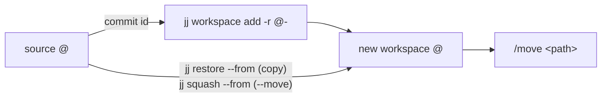

<!-- rumdl-disable MD033 -->
<h1 align="center">omp-jj</h1>

<div align="center">

**`/wt` for [jj](https://github.com/jj-vcs/jj) repos in
[oh-my-pi](https://github.com/can1357/oh-my-pi) (`omp`).**


</div>
<!-- rumdl-enable MD033 -->

`/jwt` creates a jj workspace with the changes in your current `@`, then
prepares omp's `/move` command. You choose when to switch the session.
The plugin runs jj directly, without creating a Git branch or bookmark.

This standalone workaround SHOULD eventually be upstreamed into omp's built-in
`/wt`. Access to omp's internal session relocation and worktree lifecycle
machinery could let `/wt` handle both in one flow. This extension uses explicit
`/jwt` then `/move` commands and leaves workspace cleanup to you.

```console
/jwt feat-auth
/move ~/.omp/jj-wt/myrepo/feat-auth      ← already typed in for you, press Enter
```

## Usage

```text
/jwt [name] [--move]
```

- `name` defaults to `wt-<yyyymmdd-hhmmss>`. It becomes both the jj workspace
  name and the directory name. Names may contain letters, digits, `.`, `_`,
  and `-`, but cannot start with `-` or be `.` or `..`.
- Without `--move`, the changes in your current `@` are copied, so both
  workspaces have them.
- With `--move`, they're taken out of the source workspace, which is left on an
  empty `@` with the same parent.

Extensions can't relocate a session themselves, so `/jwt` puts
`/move <path>` in the TUI editor and you press Enter. RPC clients with a UI
receive a notification. With no UI, the result or error goes to stderr so
JSON/RPC output on stdout stays valid.

## How it works



The new workspace starts from `@-`, not `@`. If it started as a child of `@`,
every snapshot in the source workspace would rewrite `@`, rebase the child, and
leave the new workspace stale. The changes are then brought over by running
`jj restore` or `jj squash` from inside the new workspace, so its files are
updated in the same operation. After `--move`, `jj workspace update-stale`
runs in the source, since squashing rewrote its `@` from outside.

| File               | Job                                                     |
| ------------------ | ------------------------------------------------------- |
| `src/index.ts`     | Registers `/jwt`, reports the result, pre-fills `/move` |
| `src/workspace.ts` | Argument parsing and the jj command sequence            |
| `src/constants.ts` | Command name and where workspaces live                  |

Workspaces go under `~/.omp/jj-wt/<source-workspace-directory>/<name>`.
For a checkout named `myrepo`, that's `~/.omp/jj-wt/myrepo/<name>`. Running
`/jwt` from a workspace named `feat-auth` instead uses the `feat-auth`
directory as its bucket. Checkouts with the same directory name share a
bucket; an existing destination is never overwritten.

These directories stay outside omp's `~/.omp/wt`, where
`omp worktree clear` may delete directories it doesn't recognise.

## Limits

- Ignored files (`node_modules`, build output) aren't carried over. Reinstall
  in the new workspace.
- `--move` uses `jj squash`: jj abandons the source change and rebases its
  descendants. Use the default copy mode to leave the source history alone.
- Creation and transfer are separate jj operations. If transfer or source
  refresh fails, the error includes the destination path. Inspect both
  workspaces before retrying; the plugin never deletes one to roll back.
- Nothing cleans workspaces up for you. Keep any changes you need, then run
  this from another workspace of the same repository:

  ```sh
  jj workspace forget feat-auth
  rm -r -- "$HOME/.omp/jj-wt/myrepo/feat-auth"
  ```

## Requirements

- [`omp`](https://github.com/can1357/oh-my-pi). Runtime smoke-tested with
  18.11.0; typechecked against the 18.4.9 extension API.
- `jj` on your `PATH`. Tested with 0.46.0 in colocated and non-colocated repos.

## Install

```sh
omp plugin install github:MrDwarf7/omp-jj
```

omp loads the TypeScript entry point directly. There are no runtime package
dependencies; omp supplies the extension API.

To pin a different tag or commit, append `#<tag-or-commit>` to the install
target. Update or remove the plugin with:

```sh
omp plugin upgrade omp-jj
omp plugin uninstall omp-jj
```

## Releases

Pin the initial release with:

```sh
omp plugin install github:MrDwarf7/omp-jj#v0.1.0
```

For a later release, update and verify `package.json`'s version, commit and
push the change, then push a matching `v<version>` tag. The tag workflow checks
the version and creates a GitHub Release with generated notes; GitHub provides
the source archives.

## Configuration

| Variable        | Effect                                                 |
| --------------- | ------------------------------------------------------ |
| `OMP_JJ_WT_DIR` | Where workspaces are created (default `~/.omp/jj-wt`)  |

Use a directory you control. Workspace creation follows existing ancestor
symlinks and inherits your local jj configuration, including signing
programs. This plugin is not a sandbox. Each jj subprocess has a 60-second
timeout.

## Development

Link a local checkout so omp loads your working tree on the next start:

```sh
omp plugin link .
bun install          # dev-only: type packages and the TypeScript compiler
bun test             # 13 tests; jj integration tests skip if jj is missing
bun run typecheck    # strict typecheck
```

The tests run jj with an empty config, so your own signing, editor, or revset
settings don't affect them.

## Troubleshooting

- If jj cannot find a workspace, start omp inside a jj repository. Use
  omp's `/wt` for a plain Git repository.
- If a name or destination already exists, choose another name. Workspace
  names are shared across all workspaces of one jj repository.
- If setup fails after creating a workspace, the error gives its path.
  Check `jj status` there and in the source. If the source reports a stale
  working copy after `--move`, run `jj workspace update-stale` in the source.
- If jj times out, check your repository locks and signing configuration
  before retrying. A timeout can leave completed jj operations behind.
